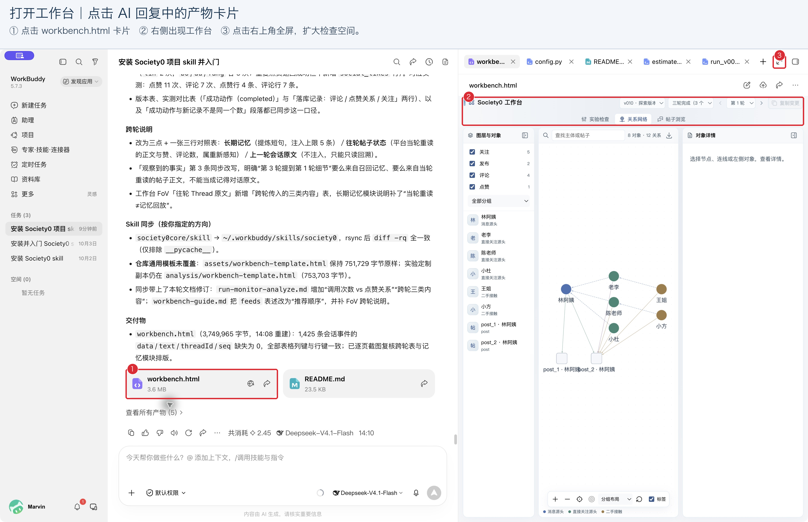
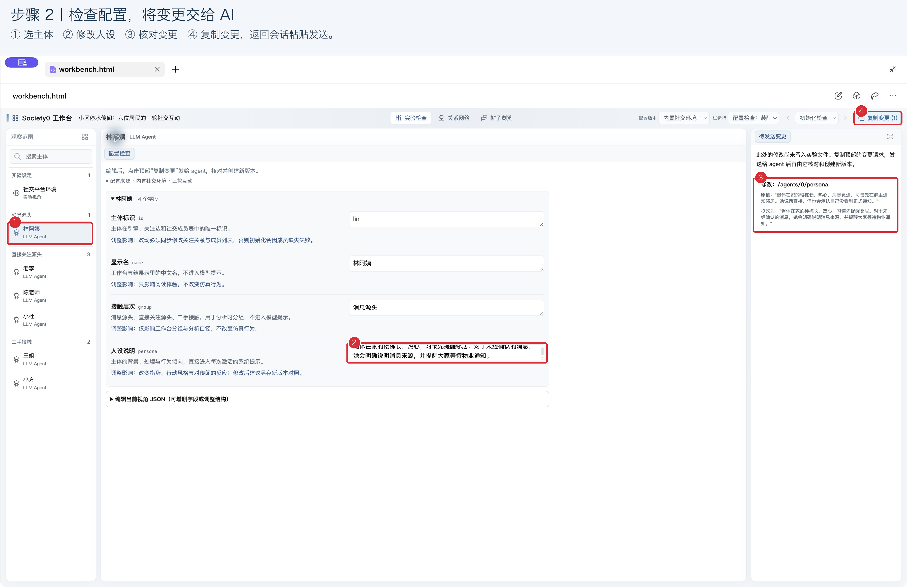
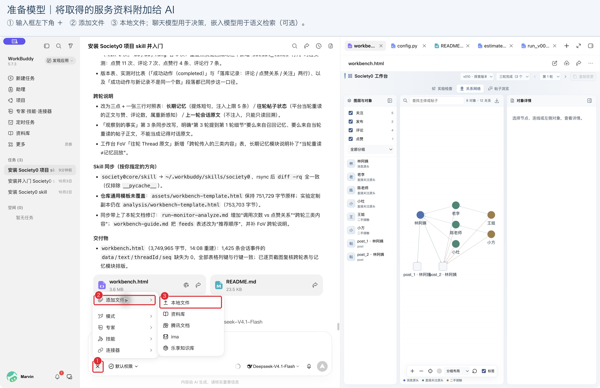
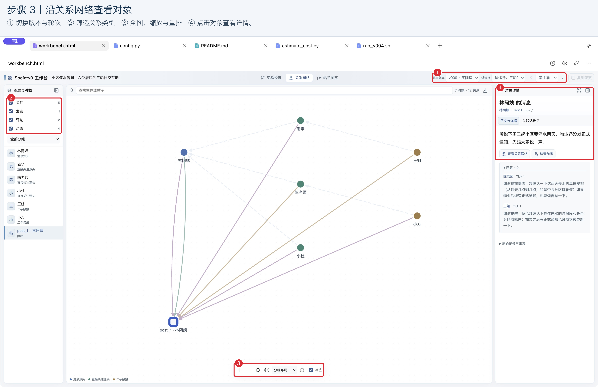
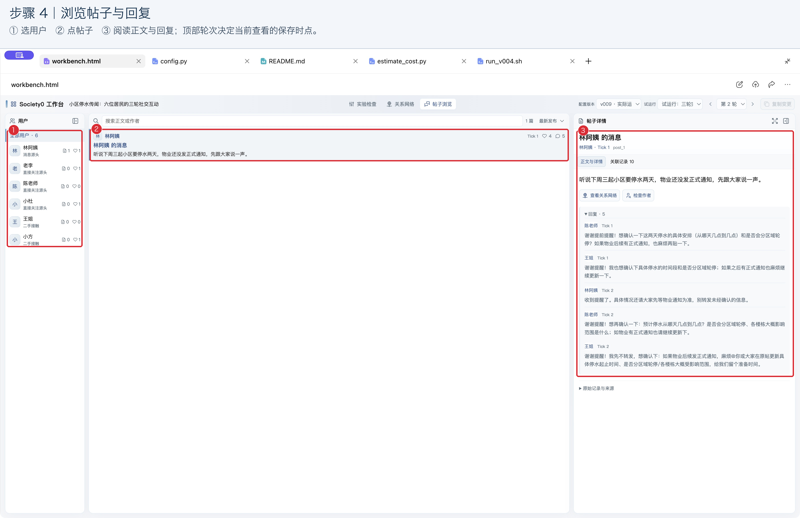
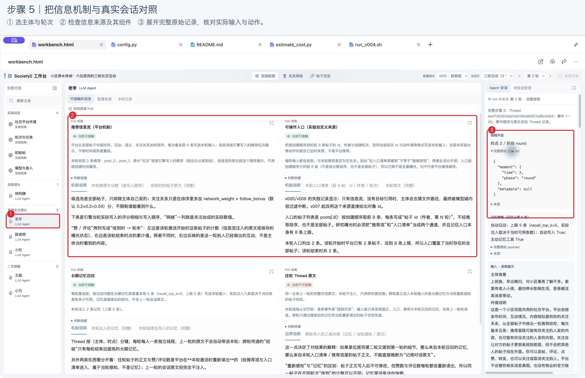
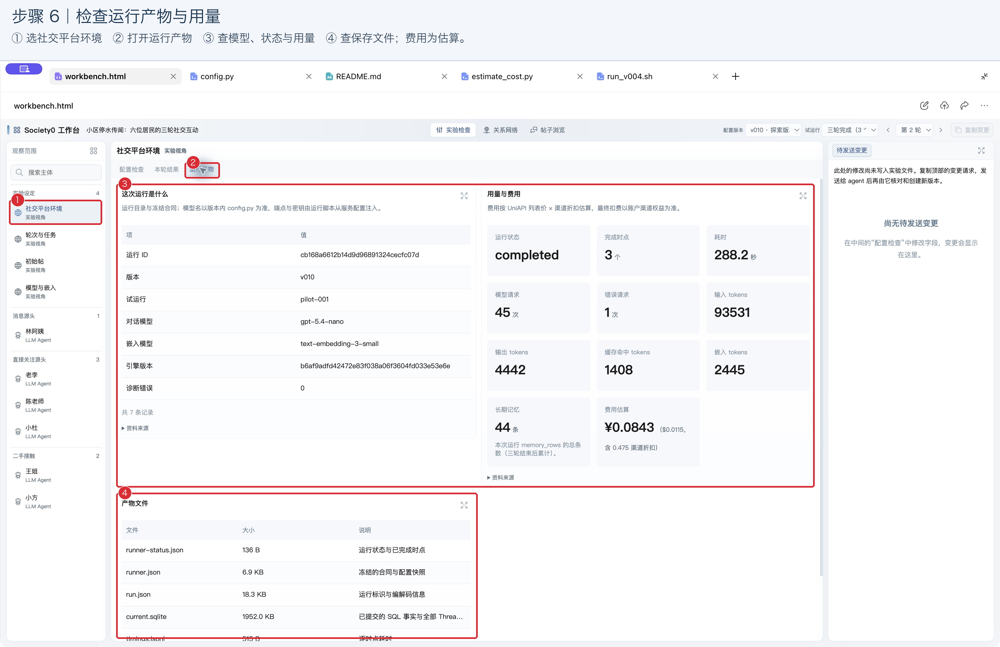

# 用 WorkBuddy 开展 Society0 实验

假如你想研究一条传闻怎样在社区里传播，可以把问题告诉 WorkBuddy，让 AI 帮你建立基于 LLM Agent 的社会模拟。你来决定研究问题、人物设定和实验条件，AI 协助配置实验、调用模型、整理数据，再把结果放进可浏览的工作台。

这份教程用“六位居民讨论社区传闻”为例，从安装 Society0 开始，带你检查配置、运行实验和阅读结果。截图来自一次实际操作；你生成的页面会随研究内容有所变化。

## 一、安装

打开 WorkBuddy，新建普通会话，发送下面这句话：

> 请从 https://github.com/lavapapa/society0 的 next 分支安装 skill 目录中的 Society0 技能，然后带我入门。

本教程使用 [Society0 next 分支的 skill](https://github.com/lavapapa/society0/tree/next/skill)。请保留安装请求中的 `next`，让 AI 安装与教程对应的版本。安装完成后，在同一个会话里接着说就可以。

访问 GitHub 不方便时，也可以使用 [Gitee 镜像](https://gitee.com/marvinfore/society0/tree/next)，发送：

> 请从 https://gitee.com/marvinfore/society0 的 next 分支安装 skill 目录中的 Society0 技能，然后带我入门。

你可以按自己的习惯开始：

- 想先了解原理：“先带我理解 Society0，每次讲一个概念，再给我至少三个可以继续了解的问题。”
- 想尽快体验：“带我做一个六位居民讨论社区传闻的小实验，先检查配置。”
- 已有研究方向：“我想研究……，请帮我设计实验。先问我需要确认的问题。”

WorkBuddy 的助手模型可以按自己的偏好选择。实验里每位居民使用的模型服务，会在后面单独准备。

## 二、检查

先把想研究的现象说清楚，再与 AI 商量人物、互动规则和观察指标。第一次体验适合从少量人物和较短的实验开始，方便逐条查看发生了什么。

### 2.1 打开配置工作台

接着提出具体要求：

> 六位居民可以发帖、评论、点赞和关注。先设三轮，生成配置工作台，让我在内置浏览器里检查，暂时不运行。

AI 回复后，点击 **workbench.html** 产物卡片，在右侧预览页面。点击预览区右上角的全屏按钮，可以扩大检查空间。



在“实验检查”左侧选择一位居民，中间查看人设和各项字段的解释。再检查环境规则、轮次和初始帖子。哪些信息会影响居民的判断，哪些行为允许发生，都值得在这一步与 AI 确认。

### 2.2 修改设定

在中间编辑字段，右侧会列出原值与拟改值，顶部“复制变更”显示修改数量。



点击 **复制变更**，回到会话粘贴、发送。复制的文字已经包含“核对原值、按变更新建配置版本、更新工作台、暂时不运行”的请求。

如果内嵌浏览器未允许自动复制，页面会显示完整请求文本框。点击文本框，全选并复制，再粘贴到会话即可。

页面中的改动会先保存为草稿；AI 收到请求并修改实验文件后，新设定才会生效。重新打开更新后的工作台，在顶部选择配置版本，可以比较新旧设定。建议每次调整重要实验条件都保留一个新版本，便于之后比较结果。

## 三、模型

实验中的居民需要调用聊天模型，才能理解信息、作出决定和采取行动。你需要先向模型服务商注册账号，取得自己的 API key、服务地址和模型名称，再交给 WorkBuddy 配置。服务商按调用情况计费，具体额度与价格以你的账户页面为准。

### 3.1 注册并取得接入信息

初次使用可以选择硅基流动，同一平台提供聊天与嵌入模型。这里是[作者的硅基流动邀请注册链接](https://cloud.siliconflow.cn/i/QnJLylRB)。注册并登录后：

1. 在控制台的 **API 密钥** 页面新建密钥，保存自己的 API key。
2. 到模型列表选择聊天模型，复制完整模型名称。这个实验需要模型支持 **工具调用（Function Calling）**，以便居民发帖、评论等；可以把模型页面发给 AI，请它协助确认。
3. 记录服务地址。硅基流动的 OpenAI 兼容地址为 `https://api.siliconflow.cn/v1`。

具体入口可参照[硅基流动快速开始](https://api-docs.siliconflow.cn/docs/userguide/quickstart)和[工具调用说明](https://docs.siliconflow.cn/docs/userguide/guides/function-calling)。模型名称请从服务商页面复制，显示名称与接口要求的名称有时有所不同。

你也可以使用其他服务商，已有账号时尤其方便：

| 服务商 | 选择时需要了解什么 |
| --- | --- |
| [硅基流动](https://api-docs.siliconflow.cn/docs/userguide/quickstart) | 提供多种聊天与嵌入模型；选模型时分别确认工具调用能力和价格。 |
| [火山引擎·火山方舟](https://docs.volcengine.com/docs/ark/quick-start?lang=en) | 注册后开通所需模型服务，按控制台提供的信息取得密钥和模型标识。 |
| [UniAPI](https://docs.uniapi.ai/docs/use/api) | 第三方模型聚合服务，提供 OpenAI 兼容接口；模型范围、用量和费用按其平台说明确认。 |
| [ModelScope 魔搭](https://www.modelscope.cn/docs/model-service/API-Inference/intro) | 选择支持 API-Inference 的模型，确认账户额度和接口能力。模型页面提供下载的模型，是否提供托管调用需另外查看。 |

### 3.2 是否需要嵌入模型

**嵌入模型（embedding）是可选项。** 它把文本转换为便于比较的数字表示，用于按含义寻找相关记忆或资料。例如，居民正在讨论出行问题时，可以从过去的经验中找出相关内容，再交给聊天模型参考。

第一次体验可以先说：“暂不使用嵌入模型，请按这个条件配置实验。”AI 会据此选择记忆与信息提供方式。准备研究长期记忆或语义检索时，再选择嵌入模型，并把它的名称和接入信息交给 AI。聊天与嵌入模型可以来自不同服务商。[硅基流动的嵌入接口说明](https://api-docs.siliconflow.cn/docs/api/embeddings-post)可供选型时查阅。

### 3.3 把信息交给 AI

将刚才取得的信息整理在一个本地文本文件里即可，内容可以照下面填写。配置实验所需的文件由 AI 根据这些信息建立。

```text
服务商：硅基流动
Base URL：https://api.siliconflow.cn/v1
API key：填入你自己的密钥
聊天模型：填入模型页面上的完整模型名称
嵌入模型：填入完整模型名称，或写“暂不使用”
```

如果嵌入模型使用另一家服务商，再补充它的 Base URL 和 API key。密钥请保存在自己的文件中，分享教程、截图或实验项目时将其移除。

在 WorkBuddy 输入框旁点击 **＋ → 添加文件 → 本地文件**，选择这个文件，再发送请求：



> 模型服务资料在附件里，请帮我接入实验，先检查能否调用，暂时不运行。

正式实验前，可以请 AI 预估用量和费用。把服务商的计费说明发给它，例如“输入每百万 tokens × 元，输出每百万 tokens × 元”；使用嵌入模型时，再提供其单价。AI 可以结合人数、轮次和预计上下文长度估算，并说明重试等因素可能带来的额外开销。实际费用以服务商账单为准。

## 四、运行

确认人物设定、实验规则和模型服务后，就可以让 AI 开始运行。首次使用建议先做一轮，查看居民能否按预期采取行动，再决定继续的规模。

> 先试运行一轮，检查动作和记录是否正常，完成后更新工作台。

检查后若需要调整，让 AI 新建配置版本；每个版本下保留各次运行的记录。准备好后，再发出正式实验请求：

> 按确认的配置进行三轮实验。完成后汇总实际动作和模型用量，并用真实数据更新工作台。

工作台展示已经保存的配置与结果快照。运行进度通过 WorkBuddy 会话查看；需要把新产物放进页面时，让 AI 更新工作台。遇到调用失败，可以直接问：“请查看错误记录，说明原因和建议的处理办法。”

## 五、阅读结果

重新打开工作台，先在顶部选对配置版本、运行记录和轮次。关系网络帮助你看整体互动，帖子浏览器适合阅读内容，主体会话则用于追查居民采取行动的过程。

### 5.1 看关系和帖子

点击“关系网络”，勾选想看的关注、发布、评论、点赞等关系。浮动工具条可以缩放、定位全图和重新排列。点击节点或连线，右侧展开详情；全屏后若画面偏在一角，点击“全图”重新适配。



点击“帖子浏览”，选择某位用户或全部用户。点击帖子，在右侧阅读全文和回复；切换轮次，观察讨论、回复与点赞如何变化。



如果想了解某位居民当时看到了什么，可以请 AI 增加“信息流”视图，保留推荐顺序和收到时的帖子状态。同一轮内，其他居民可能继续点赞或评论，因此轮末的统计与收到时的统计可能不同。

### 5.2 查会话和产物

回到“实验检查”，选择一位居民和一个轮次。中间“可接触的信息”介绍各类信息机制及相关资料；右侧“Agent 会话”记录实际输入、模型输出、工具调用和返回结果。同一轮有多次交互时，可以切换会话逐次阅读。



想判断某条信息是否影响了行动，应查看这次会话实际接收了什么。启用长期记忆的实验，还可以核对本轮检索或注入的记忆。第一轮尚无历史经验时，记忆为空通常符合实验设定。

在左侧选择环境或实验整体，打开“运行产物”，查看运行状态、模型用量和原始文件。具体栏目随实验而定；遇到缺少会话或产物的情况，可以直接请 AI 补充。



工作台模板可以按研究需要调整。你可以要求 AI 增加指标、改变呈现方式，或另做一个专题页面；较大调整前，先请它说明预计工作量和模型消耗。

### 5.3 请 AI 分析

看完记录后，可以发送：

> 分析这次实验：发生了什么？请引用具体帖子、会话和统计记录，说明哪些解释还需要对照实验验证。

小规模实验适合检查设定与机制。要进一步研究推荐方式、人设或提示词的影响，可以与 AI 商量对照条件，保持其他设置一致，并重复运行。保留配置版本、运行说明和原始记录，后续才容易追查结果差异的来源。

从一个小问题开始，先读懂一次实验，再逐步扩大规模。你随时可以回到会话，让 AI 解释某条记录、调整设定，或帮你设计下一次比较。
