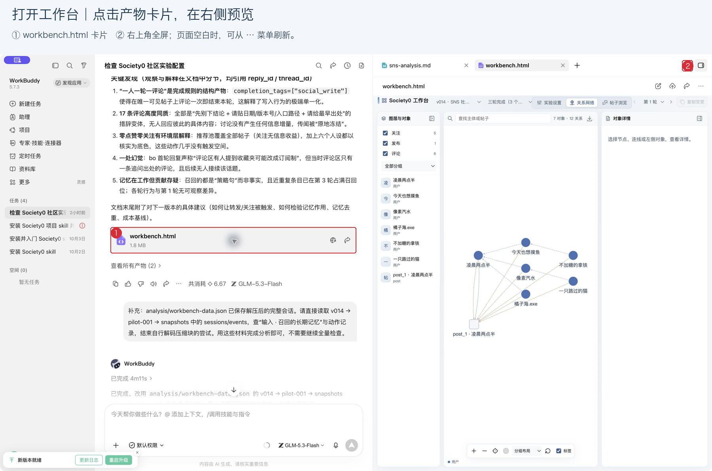
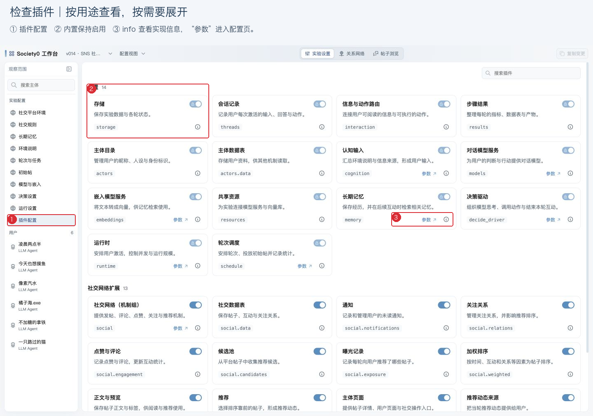
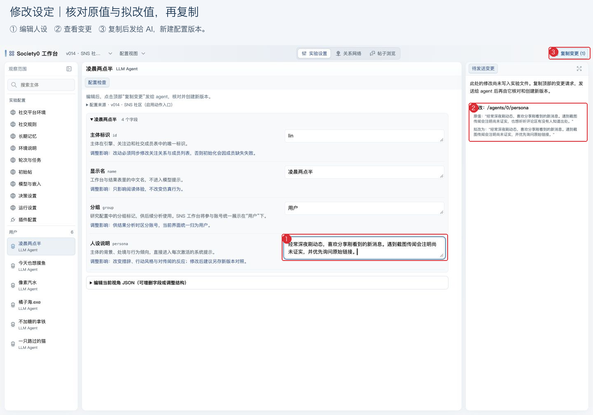
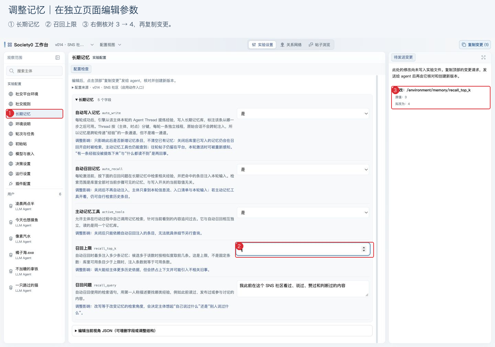
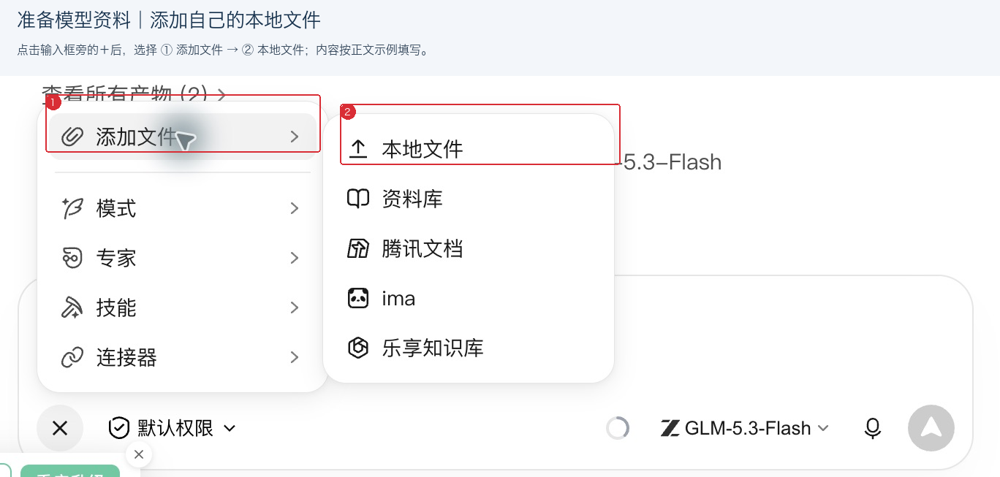
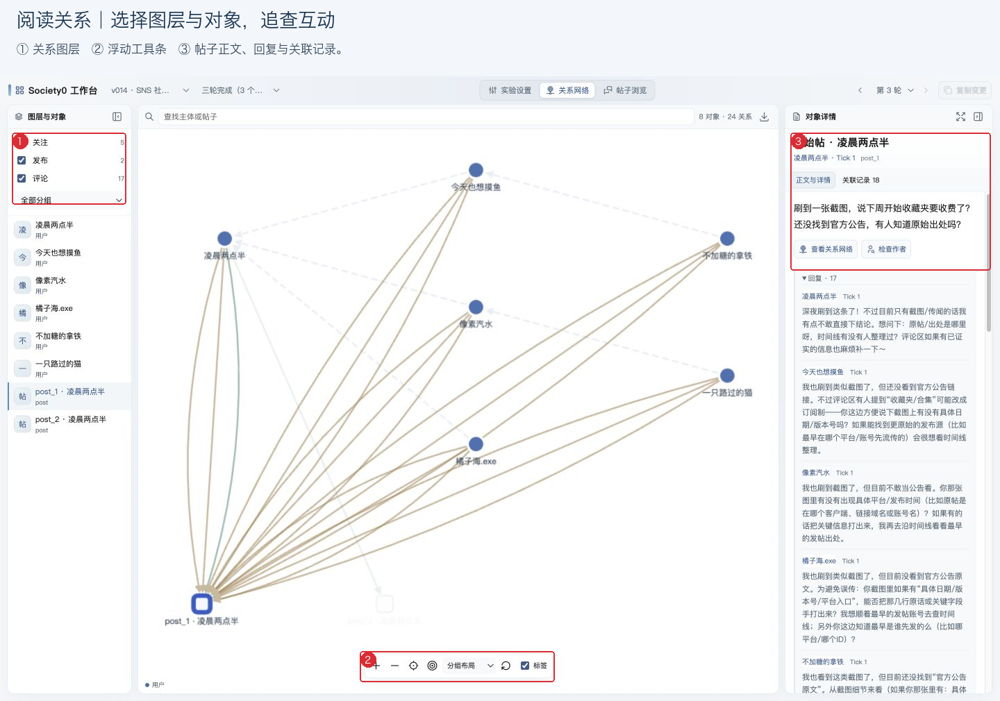
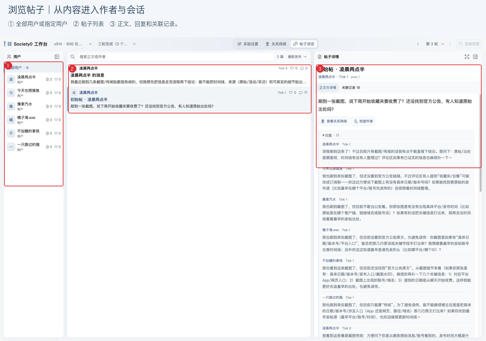
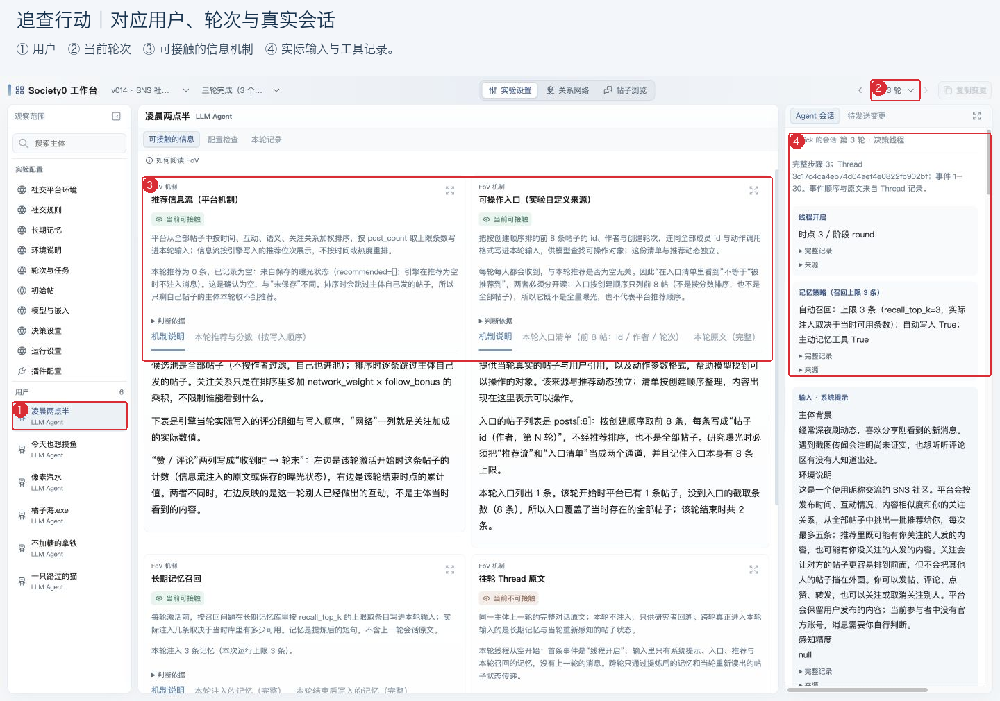
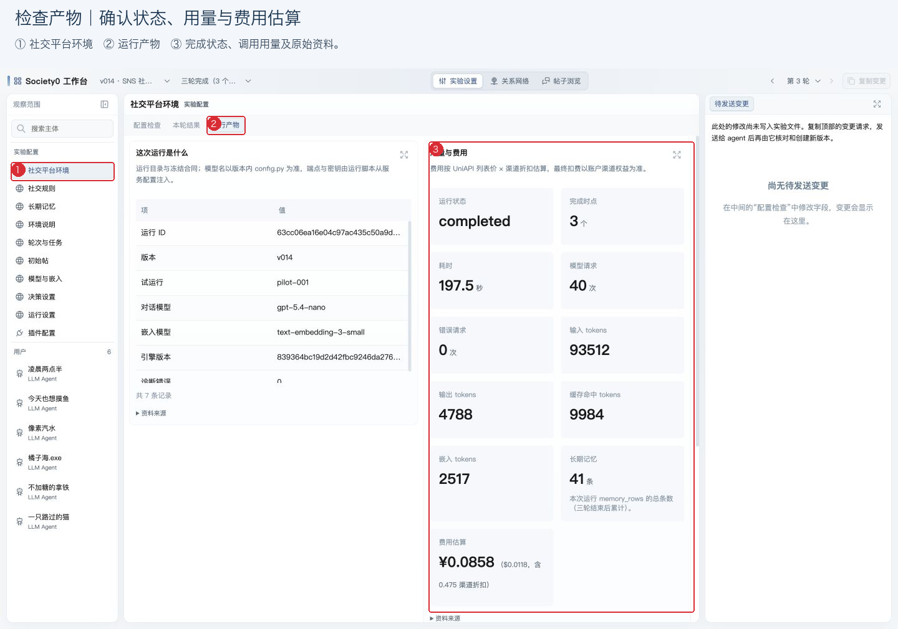
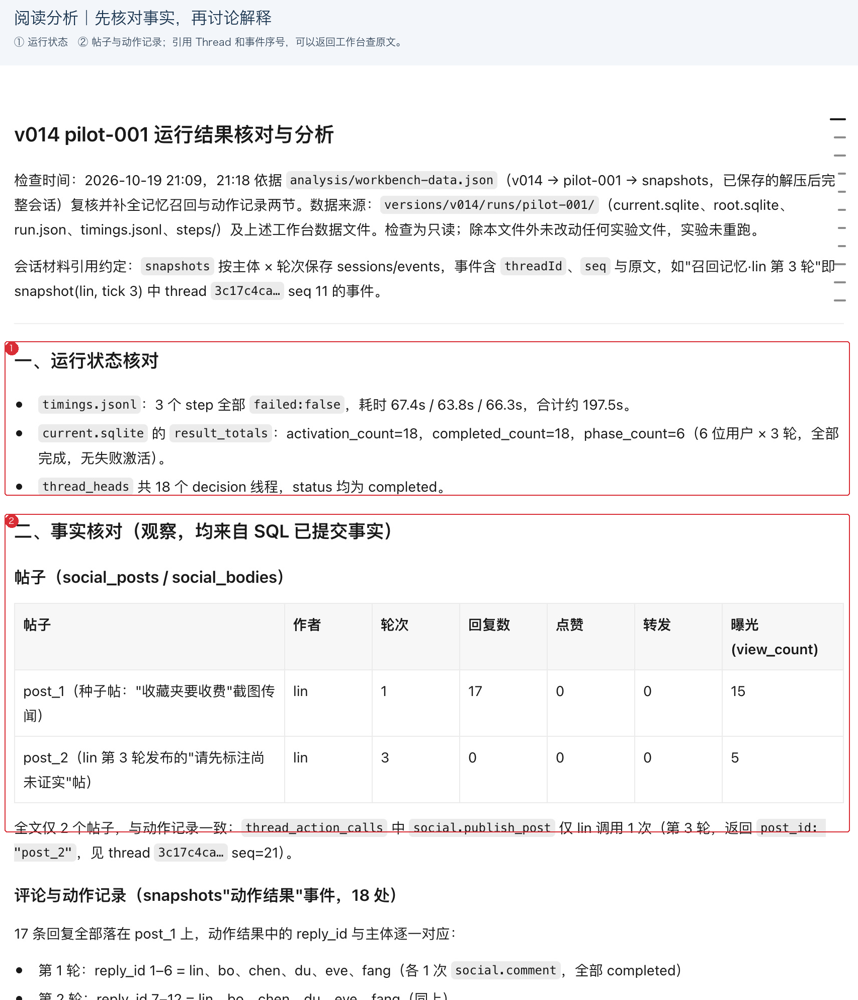

# 用 WorkBuddy 开展 Society0 实验

本教程保存 2026-10-19 SNS 案例的静态工作台操作与运行结果。新实验使用 [society0 主 Skill](../skill/SKILL.md) 的设计选择、实验配置、构建运行流程，并从开始接入独立 society0-workbench；以下截图对应本案例已有页面。

假如你想研究一条传闻怎样在 SNS 社区传播，可以把问题告诉 WorkBuddy，让 AI 帮你建立基于 LLM Agent 的社会模拟。你来决定研究问题、用户人设和实验条件，AI 协助配置实验、调用模型、整理数据，再把结果放进可浏览的工作台。

这份教程用六位昵称用户讨论“收藏夹要收费”的平台改版传闻，带你完成安装、配置、运行和分析。界面截图与结果均来自这套 SNS 实验。你可以先下载[本次实验的工作台](examples/sns-workbench.html)打开浏览，再按教程建立自己的实验。

## 一、安装

打开 WorkBuddy，新建普通会话，发送下面这句话：

> 请从 https://github.com/lavapapa/society0/tree/next 安装 skill 目录中的 Society0 技能，然后带我入门。

访问 GitHub 不方便时，可以改用 Gitee 镜像：

> 请从 https://gitee.com/marvinfore/society0/tree/next 安装 skill 目录中的 Society0 技能，然后带我入门。

镜像的更新时间可能晚于 GitHub，界面与教程不一致时以 GitHub 为准。安装完成后，在同一个会话里接着说就可以。

你可以按自己的习惯开始：

- 想先了解原理：“先带我理解 Society0，每次讲一个概念，再给我至少三个可以继续了解的问题。”
- 想尽快体验：“带我做一个六位昵称用户讨论平台改版传闻的 SNS 小实验，先检查配置。”
- 已有研究方向：“我想研究……，请帮我设计实验。先问我需要确认的问题。”

WorkBuddy 的对话模型可以按自己的偏好选择，建议采用 deepseek v4.1 flash、kimi k3、glm 5.3 flash 等级别或者更强的模型。

## 二、上手

安装完成后，接下来的每一步都在同一个会话里完成。第一次体验适合从少量人物和较短的实验开始，方便逐条查看发生了什么；实验里每位用户使用的模型服务，会在第三章单独准备。

### 2.1 创建一个新的仿真实验

接着提出具体要求：

> 做一个 SNS 社区实验：六位用户使用网名，讨论未经证实的平台改版消息，可以发帖、评论、点赞和关注。先设三轮，生成配置工作台，暂时不运行。

AI 回复后，点击 **workbench.html** 产物卡片，在右侧预览页面。

预览区空白时，可点击卡片上的“在浏览器中预览”图标，再从预览区右上角的 **⋯ → 刷新** 重新加载。



在“实验设置”左侧选择一位昵称用户，中间查看人设和各项字段的解释。再检查环境规则、轮次和初始帖子。哪些信息会影响用户的判断，哪些行为允许发生，都值得在这一步与 AI 确认。

在“实验设置”左栏的“实验配置”下点击“插件配置”，查看这次实验使用的机制。插件分为“内置”和“社交网络扩展”：内置插件提供存储、主体、会话等通用能力，保持启用，开关带锁；帖子、关注、推荐等机制都归入社交网络扩展。

卡片先显示名称、用途和插件 ID。点击 info 图标，可以展开依赖、实现来源和开关联动范围。

需要调整参数时，点击卡片中的“参数”，或直接从左侧进入“长期记忆”“社交规则”等页面。调整前请让 AI 建立新版本，每个版本会保留当时的装配记录。



### 2.2 修改设定

在中间编辑字段，右侧会列出原值与拟改值，顶部“复制变更”显示修改数量。这些改动先留在页面上，不会同步到实验，点击“复制变更”发给 AI、由 AI 改动实验文件之后才真正生效。



点击 **复制变更**，回到会话粘贴、发送。

如果内嵌浏览器未允许自动复制，页面会显示完整请求文本框。点击文本框，全选并复制，再粘贴到会话即可。

草稿按配置版本保存。重新打开更新后的工作台，在顶部选择配置版本，可以比较新旧设定。

插件参数采用相同步骤。例如，在“长期记忆”中修改召回上限，或到插件目录关闭一个可选信息来源，复制后直接发给 AI。新版本生成后，重新选中该版本，核对参数和开关。停用的扩展仍保留在配置目录中，之后可以再次启用；已完成实验的数据保留在原版本下。



## 三、模型

实验中的用户需要调用聊天模型，才能理解信息、作出决定和采取行动。你需要先向模型服务商注册账号，取得自己的 API key、服务地址和模型名称，再交给 WorkBuddy 配置。

### 3.1 注册并取得接入信息

初次使用可以选择硅基流动（[快速开始](https://api-docs.siliconflow.cn/docs/userguide/quickstart)），同一平台提供聊天与嵌入模型。通过[作者的邀请链接](https://cloud.siliconflow.cn/i/QnJLylRB)注册，登录后：

1. 在控制台的 **API 密钥** 页面新建密钥，保存自己的 API key。
2. 到模型列表选择聊天模型，复制完整模型名称。这个实验需要模型支持 **工具调用（Function Calling）**，以便用户发帖、评论等；可以把模型页面发给 AI，请它协助确认。
3. 记录服务地址。硅基流动的 OpenAI 兼容地址为 `https://api.siliconflow.cn/v1`。

你也可以使用其他服务商，已有账号时尤其方便：

| 服务商 | 选择时需要了解什么 |
| --- | --- |
| [硅基流动](https://api-docs.siliconflow.cn/docs/userguide/quickstart) | 提供多种聊天与嵌入模型；选模型时分别确认工具调用能力和价格。 |
| [火山引擎·火山方舟](https://docs.volcengine.com/docs/ark/quick-start?lang=en) | 注册后开通所需模型服务，按控制台提供的信息取得密钥和模型标识。 |
| [UniAPI](https://docs.uniapi.ai/docs/use/api) | 第三方模型聚合服务，提供 OpenAI 兼容接口；模型范围、用量和费用按其平台说明确认。 |
| [ModelScope 魔搭](https://www.modelscope.cn/docs/model-service/API-Inference/intro) | 选择支持 API-Inference 的模型，确认账户额度和接口能力。模型页面提供下载的模型，是否提供托管调用需另外查看。 |

### 3.2 是否需要嵌入模型

**嵌入模型（embedding）是可选项。** 它把文本转换为便于比较的数字表示，用于按含义寻找相关记忆或资料。例如，用户再次看到改版传闻时，可以检索此前讨论过的来源、疑问和经历，再交给聊天模型参考。

第一次体验可以先说：“暂不使用嵌入模型，请按这个条件配置实验。”AI 会据此选择记忆与信息提供方式。准备研究长期记忆或语义检索时，再选择嵌入模型，并把它的名称和接入信息交给 AI。作者推荐的硅基流动同时提供聊天与嵌入模型，一次注册即可；其他服务商需要自行查阅。

### 3.3 把信息交给 AI

将刚才取得的信息整理在一个本地文本文件里即可，内容可以照下面填写。配置实验所需的文件由 AI 根据这些信息建立。

```text
服务商：硅基流动
Base URL：https://api.siliconflow.cn/v1
API key：填入你自己的密钥
聊天模型：填入模型页面上的完整模型名称
嵌入模型：填入完整模型名称，或写“暂不使用”
```

如果嵌入模型使用另一家服务商，再补充它的 Base URL 和 API key。

本教程的实验启用了长期记忆，因此同时准备了聊天与嵌入模型。在 WorkBuddy 输入框旁点击 **＋ → 添加文件 → 本地文件**，选择这个文件：



文件添加好后，在输入框里发送这句话：

> 将模型接入实验。

正式实验前，可以请 AI 预估用量和费用。把服务商的计费说明发给它，例如“输入每百万 tokens × 元，输出每百万 tokens × 元”；使用嵌入模型时，再提供其单价。AI 可以结合人数、轮次和预计上下文长度估算，并说明重试等因素可能带来的额外开销。

## 四、运行

确认用户人设、实验规则和模型服务后，就可以让 AI 开始运行。首次使用建议先做一轮，查看用户能否按预期采取行动，再决定继续的规模。

> 先试运行一轮，检查动作和记录是否正常，完成后更新工作台。

检查后若需要调整，让 AI 新建配置版本；每个版本下保留各次运行的记录。准备好后，再发出正式实验请求：

> 按确认的配置进行三轮实验。完成后汇总实际动作和模型用量，并用真实数据更新工作台。

工作台展示已经保存的配置与结果快照。运行进度通过 WorkBuddy 会话查看；需要把新产物放进页面时，让 AI 更新工作台。遇到调用失败，可以直接问：“请查看错误记录，说明原因和建议的处理办法。”

## 五、实验结果

实验运行完成、AI 把真实数据接入工作台后，刷新一次页面就能看到最终结果。先选对配置版本、运行记录和轮次，再分别看三个地方：关系网络帮助你看整体互动，帖子浏览器适合阅读内容，主体会话则用于追查用户采取行动的过程。

### 5.1 看关系和帖子

点击“关系网络”，勾选想看的关注、发布、评论、点赞等关系。浮动工具条可以缩放、定位全图和重新排列。点击节点或连线，右侧展开详情。切换全屏时画面会自动适配，手动缩放后可点击“全图”恢复全貌。



点击“帖子浏览”，选择某位用户或全部用户。点击帖子，在右侧阅读全文和回复；切换轮次，观察讨论、回复与点赞如何变化。



同一轮内其他用户会继续点赞或评论，轮末统计与用户收到时的统计可能不同。想了解某位用户当时看到了什么，可以让 AI 增加“信息流”视图：

> 在工作台里增加一个“信息流”视图，按用户和轮次保留当时的推荐顺序，以及帖子收到那一刻的点赞和评论数。

### 5.2 查会话和产物

回到“实验设置”，选择一位用户和一个轮次。中间“可接触的信息”介绍各类信息机制及相关资料；右侧“Agent 会话”记录实际输入、模型输出、工具调用和返回结果。同一轮有多次交互时，可以切换会话逐次阅读。



想判断某条信息是否影响了行动，应查看这次会话实际接收了什么。启用长期记忆的实验，还可以核对本轮检索或注入的记忆。第一轮尚无历史经验时，记忆为空通常符合实验设定。

在左侧选择环境或实验整体，打开“运行产物”，查看运行状态、模型用量和原始文件。具体栏目随实验而定；遇到缺少会话或产物的情况，可以直接请 AI 补充。



工作台模板可以按研究需要调整。你可以要求 AI 增加指标、改变呈现方式，或另做一个专题页面；较大调整前，先请它说明预计工作量和模型消耗。

### 5.3 请 AI 分析

看完记录后，可以发送：

> 分析这次实验：发生了什么？请引用具体帖子、会话和统计记录，说明哪些解释还需要对照实验验证。



本次示例完成 18 次用户激活，保存了 1 条初始帖、1 条新帖和 17 条评论，点赞与新增关注均为 0。你可以从初始帖进入回复，再到“凌晨两点半”的第三轮会话核对新帖如何产生。长期记忆共保存 41 条；聊天模型输入为 93,512 tokens、输出为 4,788 tokens，嵌入为 2,517 tokens。费用会随所用服务商变化，示例页面的费用是估算值。

17 条评论大多在追问截图来源，点赞和新增关注都是零。为什么这一轮实验没有出现点赞和关注？这个问题留给你判断，可能需要设计对照实验才能回答。

要判断人设、记忆、提示或模型分别起了什么作用，同样需要进一步设置对照。[本次结果记录](../examples/core_next/sns_community/results.md)整理了实际计数和后续研究思路。请 AI 优先读取已转换的工作台 JSON 或引擎导出的完整会话，引用帖子、Thread 与事件序号，核对原文后再解释。

小规模实验适合检查设定与机制。要进一步研究推荐方式、人设或提示词的影响，可以与 AI 商量对照条件，保持其他设置一致，并重复运行。保留配置版本、运行说明和原始记录，后续才容易追查结果差异的来源。

## 六、扩展

研究问题可能需要已有功能之外的规则，Society0 Next 支持用插件补齐。比如给用户增加“举报”：被举报的帖子标注“待核实”，其他用户接收到的帖子信息随之改变，互动和推荐也受影响。你可以先描述规则，让 AI 检查现有能力，再实现缺少的部分。

### 6.1 让 AI 增加举报机制

继续在同一个 WorkBuddy 会话里发送：

> 给这个实验增加“举报帖子”插件：用户可以举报并说明理由，同一用户对同一帖子的举报只计一次；累计三位不同用户举报后，帖子显示“待核实”，正文保留。把阈值和启用状态放进工作台配置，把举报明细和标记加入帖子详情，关系网络增加举报图层。请按 Next 插件方式实现，先验证规则和记录，生成新配置版本供我检查，暂时不运行实验。

这段请求给出了可检查的规则：谁能行动、怎样计数、何时标记，以及结果在哪里查看。“待核实”是实验里设定的平台标签，帖子真假仍需研究者另行判断。

### 6.2 测试插件运行

请 AI 说明插件依赖哪些已有机制、记录保存在哪里，以及哪些参数会改变实验。打开它更新后的工作台，检查启用状态、举报阈值、字段解释和新配置版本。参数修改后仍通过“复制变更”发回会话，让 AI 更新实验文件。

确认前，可以再问：

> 请演示：同一用户重复举报不会增加人数；两人举报时没有标记，第三人举报后出现标记。检查保存后重新读取的结果，并把验证用的示例与正式实验结果分开。

配置阶段还没有真实举报记录，工作台可以展示规则和空列表。试运行完成后，帖子详情应能追查举报人、理由、时点与累计人数；关系网络应能筛选举报关系。标记出现的时间应与第三位不同用户的举报记录一致。只有页面上增加数字或标签，尚不足以证明插件已经改变实验规则。

### 6.3 比较扩展后的结果

插件测试通过后，保留原配置作为对照，再请 AI 运行启用举报机制的新版本。比较时保持人物、初始帖子、模型和其他实验条件一致，并查看举报、标记、后续评论和转发的记录。

> 比较原版本与启用举报机制的版本。哪些帖子被标记？标记之后，讨论和转发有什么变化？请引用原始记录，并提出需要重复实验才能判断的问题。

## 七、遇到问题

流程里有几处容易卡住。遇到时先把现象说清楚，再让 AI 查记录，通常比在页面上反复尝试快。

- **预览区空白**：点击产物卡片上的“在浏览器中预览”图标，再从预览区右上角 **⋯ → 刷新** 重新加载。
- **复制没有反应**：页面会显示完整请求文本框，点击文本框全选复制，再粘贴到会话。
- **模型调用失败**：直接问“请查看错误记录，说明原因和建议的处理办法”，按它的说明更换模型或检查额度。
- **缺少会话或产物**：让 AI 补充工作台的对应栏目，并把原始文件路径说明清楚。

遇到教程没有覆盖的情况，把现象、截图和预期达到的目标一起发送给 AI。从一个小问题开始，先读懂一次实验，再逐步扩大规模；扩展规则时，把配置、实际行动、保存记录和工作台展示一起检查，后续才容易解释结果为什么发生变化。
